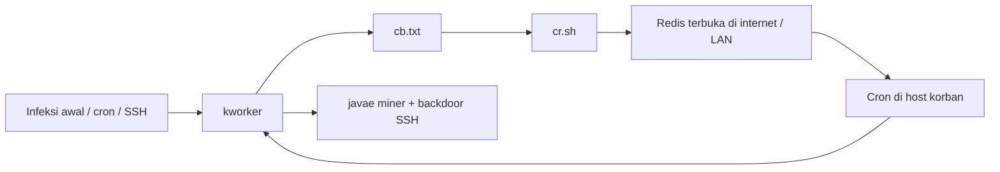

# Laporan Analisis Malware — Rangkaian `kworker`, `cb.txt`, dan `cr.sh`

| Field | Nilai |
|--------|--------|
| **Cakupan** | Tiga sampel berkas dalam koleksi yang sama |
| **Berkas** | `kworker`, `cb.txt`, `cr.sh` |
| **Tanggal analisis** | 12 April 2026 |
| **Metode** | Analisis statis (isi skrip) |
| **Klasifikasi keseluruhan** | Rantai serangan berkelanjutan: dropper/persistensi/miner, stager persiapan scanner, worm penyebaran via Redis |

---

## 1. Ringkasan eksekutif

Tiga berkas ini merupakan **bagian dari satu kampanye** yang saling mengisi:

1. **`kworker`** — skrip utama yang **melemahkan keamanan host**, menghapus agen cloud/EDR pesaing, memasang **backdoor SSH**, **persistensi cron**, **miner** (`javae`), **penyamaran** `ps`/`top`/`pstree`, dan di akhir memanggil **`cb.txt`**.
2. **`cb.txt`** — **stager** yang memasang dependensi (**Redis**, **masscan**, **pnscan**, toolchain build), membersihkan proses pesaing, mengunci beberapa path dengan `chattr`, lalu mengunduh dan menjalankan **`cr.sh`**.
3. **`cr.sh`** — modul **penyebaran massal** yang memanfaatkan **Redis tanpa autentikasi / salah konfigurasi**: menulis **cron** di host korban melalui fitur persistensi Redis (`CONFIG SET dir` + `dbfilename`), sehingga host lain menarik dan menjalankan **`kworker`** lagi.

Secara bersamaan, kampanye ini mencapai **kompromi mendalam pada server**, **cryptomining**, **worm-like lateral movement**, dan **pembunuhan** tool/miner milik aktor lain pada host yang sama.

---

## 2. Diagram rantai (kill chain)

**Alur data:**

- `kworker` (baris akhir) dan `cb.txt` (baris akhir) memanggil URL yang sama untuk stage berikutnya (`cb.txt` ↔ `cr.sh`).
- `cr.sh` menyisipkan perintah cron yang mengunduh **`kworker`** dari C2, sehingga siklus tertutup.

---

## 3. Analisis per berkas

### 3.1 `kworker` (dropper orkestrator)

| Aspek | Deskripsi |
|--------|------------|
| **Interpreter** | `#!/bin/sh` |
| **Peran** | Orkestrasi utama pasca-akses |

**Perilaku utama (ringkas):**

- Menonaktifkan atau mengganggu lapisan pertahanan: `iptables`/`ufw`, SELinux, AppArmor, NMI watchdog, log (`syslog`, history, `wtmp`, dll.).
- Menghapus atau menonaktifkan agen keamanan cloud (Alibaba Aegis, Tencent YunJing, Alibaba Cloud Monitor, BCM, dll.) termasuk payload **Base64** yang di-*decode* ke `bash`.
- Memindahkan **`curl`** → **`/usr/bin/cd1`** dan **`wget`** → **`/usr/bin/wd1`** agar unduhan berikutnya konsisten dengan skrip lain dalam kampanye.
- Fungsi besar **`kill_miner_proc`** / **`kill_sus_proc`** / **`fuckyou`**: membersihkan proses, jaringan, dan file yang diasosiasikan dengan miner/worm lain.
- **Persistensi:** cron untuk `/etc/kworker` atau `/tmp/kworker`; file **`/etc/javae`** sebagai penanda root; **`chattr +i`** pada artefak penting.
- **Evasi:** `modify_binary` pada `/bin/ps`, `/bin/top`, `/bin/pstree` agar menyembunyikan string **`javae`** dan **`pnscan`** di keluaran.
- **Backdoor SSH:** menulis kunci publik penyerang ke `authorized_keys` (root dan user).
- **Muatan:** unduh **`javae`** (~5.685.096 byte) dari C2, eksekusi lokal.
- **Propagasi lateral:** SSH ke host di `known_hosts` dengan perintah *pipe-to-bash* dari `38.150.0.136`.
- **Stage lanjutan:** `curl` / `cd1` menjalankan **`cb.txt`** | `bash`.

**Keterkaitan dengan berkas lain:** `kworker` adalah **titik akhir yang memuat `cb.txt`**; `cr.sh` dirancang agar **cron korban** menarik **`kworker`** lagi.

---

### 3.2 `cb.txt` (stager persiapan scanner / Redis client)

| Aspek | Deskripsi |
|--------|------------|
| **Interpreter** | `#!/bin/sh` |
| **Peran** | Menyiapkan lingkungan untuk `cr.sh` |

**Perilaku utama:**

- Mendefinisikan **`bbdir`/`bbdira`** (`curl` / `cd1`) dan menyalin biner ke **`cd1`** / **`wd1`** dari berbagai nama alternatif (`cur`, `cdl`, `get`, `wge`, dll.) — selaras dengan aliasing di `kworker`.
- Bekerja di direktori tersembunyi: **`/tmp/.ice-unix/...`** atau **`/var/tmp`**, dengan file kunci **`.watch`** untuk mencegah eksekusi ganda.
- Membunuh proses yang mengandung **`redisscan`**, **`ebscan`**, **`redis-cli`**, **`barad_agent`**, **`masscan`**, dan pola lain — **kompetisi** dengan aktor atau varian lain.
- **Paket manager:** `apt-get` / `yum`/`dnf` memasang **redis-server**, **redis-tools**, **masscan**, **libpcap**, **gcc/make/git**, **unhide**, dll. (meningkatkan jejak serangan dan dependensi pada host).
- Menjalankan **`unhide quick`** dan membunuh PID yang terdeteksi — pola pembersihan / anti-forensik ringan.
- Mengulangi trik **`chattr +i`** pada nama biner palsu di `/usr/bin` (sama seperti di `kworker`: `ip6network`, `kswaped`, `irqbalanced`, dll.).
- Jika **masscan** belum ada: unduh **`http://34.70.205.211/.../1.0.5.tar.gz`**, kompilasi, `make install`.
- Jika **pnscan** belum ada: unduh **`pnscan-1.14.1.tar.gz`** dari host yang sama, kompilasi.
- **Keluaran akhir:** menjalankan **`cr.sh`** dari URL:

  `http://34.70.205.211/plugins-dist/safehtml/lang/font/cr.sh`

  (dua jalur: `curl` dan `cd1`).

**Catatan implementasi:** pada baris yang memeriksa `cd1`, ada sintaks **`http_code = \`...`** (spasi di sekitar `=`) yang **tidak valid** di bash standar; di lingkungan korban, cabang itu bisa gagal dan skrip jatuh ke `wget`/`wd1`. Ini relevan untuk deteksi perilaku (percobaan multi-jalur).

---

### 3.3 `cr.sh` (worm Redis → cron)

| Aspek | Deskripsi |
|--------|------------|
| **Interpreter** | `#!/bin/bash` |
| **Peran** | Eksploitasi Redis untuk eksekusi terjadwal jarak jauh |

**Perilaku utama:**

- `setenforce 0`, `ulimit -u 50000`.
- **iptables:** aturan yang mengatur akses ke port **6379** (Redis): secara efektif **hanya localhost** yang diizinkan menuju Redis pada host pelaku skrip, lalu **DROP** untuk sumber lain — pola umum **menutup pintu** setelah atau selama pemanfaatan, atau mengurangi visibilitas dari luar.
- **Sinkronisasi dengan evasi `kworker`:** jika ada **`/bin/ps.original`**, pemeriksaan proses **`pnscan`** memakai **`ps.original`** agar tidak terfilter *wrapper*.
- Jika **`pnscan`** **tidak** terlihat berjalan, skrip membangun berkas **`.dat`** berisi urutan perintah **redis-cli** yang:

  1. Mengatur **`stop-writes-on-bgsave-error no`**, **`flushall`**, dll.
  2. Menyisipkan **string cron** sebagai nilai key Redis palsu (`backup1` … `backup4`) yang berisi perintah menjalankan **`kworker`** lewat `cd1`, `wget`, `curl`, atau `wd1`.
  3. Mengarahkan **`config set dir`** ke **`/var/spool/cron/`**, **`/var/spool/cron/crontabs`**, **`/etc/cron.d/`**, **`/etc/`** dengan **`dbfilename`** **`root`**, **`javae`**, atau **`crontab`**, lalu **`save`** — ini adalah varian klasik **Redis arbitrary file write** menuju **cron**.

- **Penemuan target:**  
  - **pnscan** ke rentang `/16` acak dengan *fingerprint* banner Linux dan port **6379**.  
  - **masscan** global (dengan *shard*), rentang privat dan cloud Tiongkok yang di-hardcode, serta jaringan lokal dari `ip a` (dikonversi ke `/16`).

- Untuk setiap host:port yang ditemukan, **`cat .dat | redis-cli -h $h -p $p --raw &`** di latar belakang — **serangan paralel masal**.

- **URL dalam cron** yang ditulis ke korban:

  - Utama: `http://34.70.205.211/plugins-dist/safehtml/lang/font/kworker`
  - Alternatif pada salah satu baris: `http://38.150.0.118/dewfhuewr4r89/98hy67//kworker` (terlihat ada **double slash** `//` — bisa jadi typo; tetap berbahaya jika server menormalisasi path).

- Jika **`pnscan`** sudah berjalan, skrip hanya mencetak **`root runing.....`** dan **tidak** melanjutkan loop penyebaran (mengurangi tabrakan dengan instansi lain).

**Dampak:** setiap **Redis terpapar** yang menerima perintah tersebut dapat menerima **file cron** yang mengeksekusi **`kworker`**, menyebabkan **kompromi berantai**.

---

## 4. Korelasi dan kesatuan kampanye

| Elemen | `kworker` | `cb.txt` | `cr.sh` |
|--------|-----------|----------|---------|
| C2 utama | `34.70.205.211` | Sama | URL `kworker` di cron |
| Aliasing curl/wget | `mv` ke `cd1`/`wd1` | `cp` ke `cd1`/`wd1` | Memakai `cd1`, `curl`, `wget`, `wd1` di cron |
| Menyembunyikan `pnscan` di `ps` | Ya (`modify_binary`) | — | Memakai `ps.original` untuk cek `pnscan` |
| Redis / masscan | — | Instalasi | Eksploitasi + scan |
| Tujuan akhir | Miner + persistensi | Menjalankan `cr.sh` | Menyebar `kworker` |

Kesimpulan: **satu toolkit** dengan peran terpisah; urutan eksekusi tipikal pada host yang sudah menjalankan `kworker`:

`kworker` → `cb.txt` | bash → `cr.sh` | bash → infeksi Redis lain → `kworker` lagi.

---

## 5. Indikator kompromi (IOC) terpadu

### 5.1 Jaringan

| URL / pola | Digunakan di |
|------------|----------------|
| `http://34.70.205.211/plugins-dist/safehtml/lang/font/kworker` | `kworker`, `cr.sh` (cron) |
| `http://34.70.205.211/plugins-dist/safehtml/lang/font/javae` | `kworker` |
| `http://34.70.205.211/plugins-dist/safehtml/lang/font/cb.txt` | `kworker` |
| `http://34.70.205.211/plugins-dist/safehtml/lang/font/cr.sh` | `cb.txt` |
| `http://34.70.205.211/plugins-dist/safehtml/lang/font/1.0.5.tar.gz` | `cb.txt` (masscan) |
| `http://34.70.205.211/plugins-dist/safehtml/lang/font/pnscan-1.14.1.tar.gz` | `cb.txt` |
| `http://38.150.0.136/dewfhuewr4r89/98hy67/kworker` | `kworker` (SSH lateral) |
| `http://38.150.0.118/dewfhuewr4r89/98hy67//kworker` | `cr.sh` (salah satu entri cron) |

### 5.2 File, direktori, dan nama proses

| Indikator | Konteks |
|-----------|---------|
| `/etc/javae`, `/etc/kworker`, `/tmp/javae`, `/tmp/kworker` | Persistensi + miner |
| `/tmp/.ice-unix/...`, `.watch` | Stager `cb.txt` |
| `.dat`, `.shard`, `.ranges`, `.lan`, `.r.*` | Artefak sementara `cr.sh` |
| `pnscan`, `masscan`, `redis-cli` ke banyak host | Aktivitas `cr.sh` |
| `/bin/ps.original`, `/bin/top.original`, `/bin/pstree.original` | Evasi oleh `kworker` |
| Cron berisi `kworker`, `javae`, `34.70.205.211`, `38.150.0.118` | Persistensi + worm |

### 5.3 Perilaku jaringan

- Lonjakan koneksi keluar ke **6379/tcp** dari host yang menjalankan `cr.sh` (scan).
- Koneksi **redis-cli** dari host korban ke banyak alamat (horizontal).
- Unduhan HTTP ke path **`/plugins-dist/safehtml/lang/font/`** — pola path mencurigakan pada IP tersebut.

---

## 6. Pemetaan MITRE ATT&CK (gabungan)

| Taktik | Contoh teknik |
|--------|----------------|
| Execution | Command and Scripting Interpreter: Unix Shell, Unix Shell (`curl\|bash`) |
| Persistence | Cron, account manipulation (SSH keys) |
| Privilege Escalation | Bergantung pada vektor awal; Redis write sering menyamai user `redis` atau root jika cron root tertulis |
| Defense Evasion | Disable/modify tools, indicator removal, filter `ps`/`top` |
| Credential Access | SSH keys existing untuk lateral (`kworker`) |
| Discovery | Network service scanning, `ip a` untuk LAN |
| Lateral Movement | Redis, SSH |
| Impact | Resource hijacking (mining), data destruction potensial (`flushall` pada Redis korban) |

**CVE relevansi:** serangan inti mengandalkan **Redis tanpa kata sandi / binding publik** dan **misconfiguration** — sering dikategorikan sebagai **exploitation of remote services** daripada satu CVE tunggal.

---

## 7. Dampak bisnis dan teknis

1. **Kerahasiaan:** backdoor SSH; data di server Redis dapat dibaca/dihapus (`flushall` dalam skrip Redis).  
2. **Integritas:** cron dan biner sistem dimodifikasi; isi Redis korban dirusak.  
3. **Ketersediaan:** beban CPU (mining + scan massal); Redis korban kehilangan data in-memory.  
4. **Reputasi & hukum:** host menjadi origen scan dan penyebaran malware.  
5. **Biaya:** waktu respons IR, rebuild, audit jaringan internal yang pernah terpapar Redis.

---

## 8. Rekomendasi respons dan pencegahan

**Respons insiden**

1. Isolasi host; snapshot disk untuk forensik bila diperlukan.  
2. Asumsikan **kredensial dan kunci SSH** pada host terkompromi; rotasi dan audit `authorized_keys` di seluruh infrastruktur terkait.  
3. Periksa **Redis**: autentikasi (`requirepass` / ACL), **bind 127.0.0.1** atau firewall ketat, nonaktifkan `CONFIG` di produksi jika memungkinkan (`rename-command CONFIG ""`).  
4. Hapus artefak: cron, `/etc/cron.d/javae`, file di `/var/spool/cron*`, `/etc/javae`, `/etc/kworker`, wrapper `ps`/`top`/`pstree`, pulihkan biner dari paket distro.  
5. Blokir IOC di perimeter; pantau outbound ke **34.70.205.211**, **38.150.0.136**, **38.150.0.118**.  
6. Preferensi **rebuild bersih** daripada pembersihan manual saja.

**Pencegahan**

- Patch dan hardening aplikasi yang menghadap internet; jangan expose Redis tanpa TLS + auth.  
- Pemantauan: anomali `masscan`/`pnscan`, instalasi paket `redis-server` tak dijelaskan, perubahan `/bin/ps`.  
- Segmentasi jaringan; deteksi scan port internal.

---

## 9. Batasan analisis

- Hanya isi **skrip teks** yang dianalisis; biner **`javae`** tidak di-*reverse engineer* di sini.  
- Hash file (SHA-256) tidak dihitung dalam laporan; tambahkan secara lokal untuk berbagi intel.  
- Perilaku runtime `cb.txt` dapat bervariasi jika cabang `curl`/`cd1` gagal karena kesalahan sintaks pada variabel `http_code`.

---

## 10. Kesimpulan

Ketiga berkas membentuk **rantai ofensif terintegrasi**: **`kworker`** menjamin **penguasaan host** dan **eksekusi jangka panjang**, **`cb.txt`** memasang **infrastruktur scan dan Redis client**, dan **`cr.sh`** melakukan **penyebaran massal** melalui **Redis** dengan menanamkan **cron** yang mengunduh **`kworker`**. Penamaan **`kworker`** tetap **kamuplase** terhadap thread kernel Linux yang sah.

Organisasi harus menangani kampanye ini sebagai **insiden kritis** dengan asumsi **banyak host** dapat terlibat jika Redis pernah terbuka ke jaringan tidak tepercaya.

---

*Laporan ini menggabungkan analisis sebelumnya pada `kworker` dengan sampel `cb.txt` dan `cr.sh` dalam direktori yang sama. Untuk distribusi IOC eksternal, ikuti kebijakan threat intelligence organisasi Anda.*
